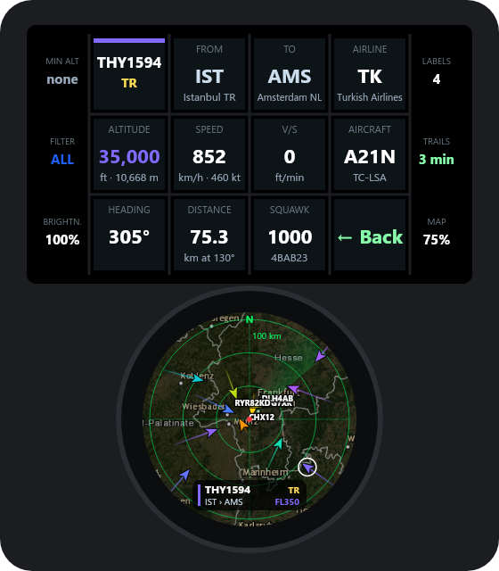
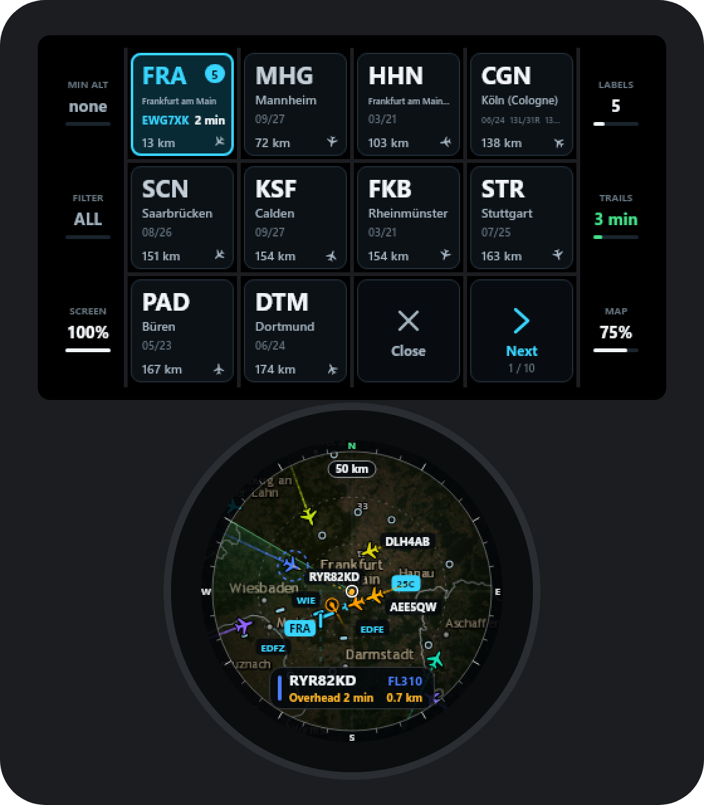
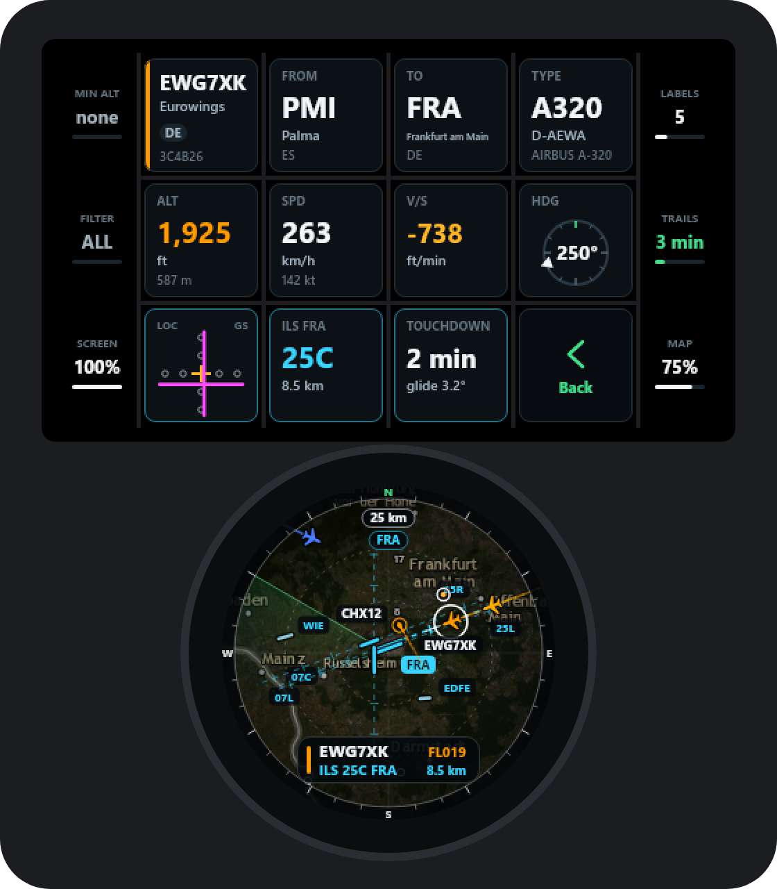
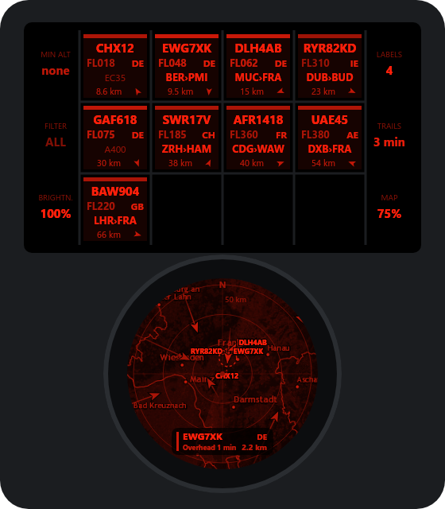

# Loupedeck CT ADS-B Radar

Turn a **Loupedeck CT** into a live aircraft radar fed by your own **tar1090 / dump1090** ADS-B receiver.

The round wheel screen becomes a radar scope over a satellite map, the touch panel lists the nearest aircraft (one per key), and the knobs and buttons drive range, filters, trails and alerts.

Screenshots use fictitious demo traffic. Map imagery: Esri, Maxar, Earthstar Geographics and the GIS User Community.

## Features

**Wheel screen (radar scope)**
- Satellite map with borders and place names under a compass rose, range rings and a radar sweep. The view can **follow** an aircraft.
- Aircraft silhouettes coloured by altitude (tar1090-style scale), fading **trails**, callsign labels that avoid each other.
- **Spotlight banner**: one aircraft at a time with callsign, flight level, route and country, cycling through the nearest ones.
- **Overflight prediction**: aircraft about to pass close to your home get a dashed projected path and a countdown ("Overhead 3 min").
- **Distress ring**: aircraft squawking 7500 / 7600 / 7700 get a pulsing red ring and take over the banner.

**Touch panel (12 keys)**
- **List**: the 12 nearest aircraft, one per key: callsign, flight level with climb / descent marker, route (or ILS runway), distance, country.
- **Detail card**: tap an aircraft and the 12 keys become its card: from / to, type and registration, altitude, speed, vertical speed, heading dial, distance, squawk, airline.
- **Airport picker**: button 2 lists the airports around you, 10 per page (airports with scheduled flights first, nearest first), with their runways, distance and the number of aircraft on approach. Tap one to jump to it.

**Airports and ILS-like approaches**
- Airports are drawn on the scope, with runways to scale when zoomed in (data: [OurAirports](https://ourairports.com), downloaded once and cached).
- The selected airport shows the extended centreline of each runway (5 km ticks); the runway in use is highlighted when traffic is established on it.
- Aircraft on final approach are detected from their position, track and altitude (aligned within 3°, on a 1.5 to 5° glide path): tiles and banner show e.g. `ILS 23 SXB`.
- In the detail card, an approach adds a cockpit-style **deviation indicator** (localizer and glide slope needles), the runway, the distance to the threshold, the time to touchdown and the actual glide angle.
- **Airport mode** centres the scope on the selected airport and lists only its traffic (on approach, inbound or outbound).

These deviations are computed from ADS-B data (position once per second, altitude in 25 ft steps, no pressure correction), not from the real ILS signal: they are indicative, not certified.

**Alerts**
- Button 8 blinks and the CT vibrates for emergencies (red), low military aircraft nearby (orange), and low aircraft / imminent overflight (yellow). An emergency aircraft is selected and followed automatically.
- Optional push notification through Home Assistant.

**Night mode**: button 1 dims everything and switches all screens to red.

**Look and feel**: colours follow glass-cockpit conventions (white data, cyan for what you can select, green for engaged modes, amber for caution, red for warnings, magenta for guidance). Knob values are echoed on the side strips, and the touch panel answers inputs immediately.

## Controls

| Control | Turn | Press |
|---|---|---|
| Big wheel | Range (10 / 25 / 50 / 100 / 200 / 300 km); pages in the airport picker | Cycle the selected aircraft; close the picker |
| Top-left knob | Minimum altitude filter | Reset |
| Middle-left knob | Filter: all, military, helicopters, low altitude, airport, heavies, overhead | Reset to all |
| Bottom-left knob | Screen brightness | |
| Top-right knob | Number of labels on the radar | Reset |
| Middle-right knob | Trail length (0 to 15 min) | Toggle trails |
| Bottom-right knob | Map brightness | Reset |

| Button | Action |
|---|---|
| Round button 1 | Night mode on / off |
| Round button 2 | Open / close the airport picker |
| Round button 3 | Airport mode on / off |
| Round button 8 | Alert indicator; press to acknowledge alerts for 5 minutes |
| A / B / C / D (arrows) | Pan the map (stops following) |
| E or Home (○) | Back to home: leaves airport mode, stops following |
| Tap a tile | Open the aircraft card and follow it on the radar |
| Tap "Back" | Back to the list, the radar returns home |
| Tap an aircraft on the wheel | Select and follow it |
| Tap an airport on the wheel | Select that airport (centrelines) |
| Tap an airport in the picker | Select it and switch to airport mode |
| Tap the airport tile (airport mode) | Open the picker |

Round buttons 4 to 7 are free for your own ideas.

## Requirements

- Loupedeck CT (hardware V1.00 / V2.00, tested with firmware 0.2.8). The CT V3.00 is supported by the underlying library but untested here.
- Windows 10 / 11 (the launch scripts and font loading are Windows-specific; the code itself is plain Node.js).
- Node.js 20 or newer.
- A tar1090 or dump1090 receiver reachable on your network (`/data/aircraft.json`).
- Internet access for the map tiles (Esri) and the airline / route lookups (adsb.lol, adsbdb.com).

## Installation

1. Download or clone this repository.
2. Double-click **`setup.bat`**. It installs Node.js if needed, installs the dependencies and creates `config.json` from `config.example.json`.
3. Edit **`config.json`**:
   - `tar1090_url`: your receiver, e.g. `http://192.168.1.50/tar1090/`
   - `lat` / `lon`: your home position (4 to 5 decimals). Tip: your tar1090 `data/receiver.json` shows it, rounded.
   - `airport`: optional, your nearest airport for the "airport" filter.
   - `language`: `en` or `fr`.
4. Double-click **`start-radar.bat`**.

The script closes the official Loupedeck / Logi Plugin Service software, because only one program can talk to the device at a time. To get your usual Loupedeck profiles back, close the radar window and start the Loupedeck software again.

**Autostart**: run `enable-autostart.bat` once; the radar then starts 30 seconds after you log in (minimised). `disable-autostart.bat` removes it.

## Configuration reference

| Key | Default | Description |
|---|---|---|
| `language` | `en` | UI language on the device: `en` or `fr` |
| `tar1090_url` | | Base URL of your tar1090 / dump1090 web interface |
| `lat`, `lon` | | Home position |
| `airport` | | `{ name, lat, lon, radius_km, below_ft }` for the airport filter |
| `airports` | | `enabled`, `radius_km` (area loaded), `types` (OurAirports types), `min_runway_ft`, `approach_km` (centreline length), `mode_range_km` (range used by airport mode), `default` (ICAO or IATA of the airport selected at start) |
| `font` | `segoe` | `segoe`, `bahnschrift` (condensed, DIN-like) or `arial` |
| `ranges_km`, `default_range_km` | 10 to 300, 100 | Radar ranges |
| `fps` | `1` | Wheel refresh rate. The CT wheel screen drops frames when flooded; 1 is safe, 2 may work |
| `input_refresh_ms` | `500` | Minimum delay between two wheel redraws triggered by an input (the touch panel always answers immediately) |
| `trail_minutes` | `3` | Default trail length |
| `labels_max` | `6` | Default number of callsign labels |
| `spotlight`, `spotlight_sec`, `spotlight_count` | `true`, `4`, `8` | Spotlight banner |
| `night_brightness` | `0.3` | Brightness in night mode |
| `alert` | | Thresholds for low aircraft / low military / emergency alerts, and `ha_notify` |
| `overflight` | | `radius_km`, `horizon_min`, `alert_min`, `spotlight_min` for the overflight prediction |
| `ha_url`, `ha_token` | empty | Home Assistant URL and long-lived token for notifications |
| `map` | | Tile layers (`url`, `opacity`, `dim`), overall `brightness`, optional `contrast` |

**Home Assistant notifications**: set `ha_url` (e.g. `http://homeassistant.local:8123`), a long-lived access token in `ha_token` (Profile > Security in Home Assistant), and the notify service in `alert.ha_notify`, e.g. `notify.mobile_app_my_phone`.

## How it works

- Talks to the CT directly over USB serial with the excellent [`loupedeck`](https://github.com/foxxyz/loupedeck) Node.js library, and draws with [`@napi-rs/canvas`](https://github.com/Brooooooklyn/canvas).
- Aircraft come from your receiver's `aircraft.json` (both the dump1090 and readsb formats are supported).
- Routes come from the [adsb.lol](https://api.adsb.lol/docs) route API, which checks them against the aircraft position; airline and aircraft type come from the free [adsbdb.com](https://www.adsbdb.com) API (also a route fallback). At most one lookup per second, cached in `infos-cache.json`. Charter, private and military flights may still show no route.
- Military detection is a heuristic based on known ICAO address blocks and callsign prefixes.
- Overflight prediction assumes straight-line flight, so turning or approaching aircraft may deviate.
- Map tiles are cached in `tiles/`.

## Screenshots

`render-screenshots.bat` (or `node radar.js --screenshots`) regenerates the images in `docs/screenshots` with fictitious traffic around Frankfurt. No device is needed. Add `--fr` for the French UI.

## Credits

- [foxxyz/loupedeck](https://github.com/foxxyz/loupedeck): unofficial Loupedeck Node.js API
- [tar1090](https://github.com/wiedehopf/tar1090): altitude colour scale and military address ranges inspiration
- [adsb.lol](https://adsb.lol): route data
- [OurAirports](https://ourairports.com): airport and runway data (public domain)
- [adsbdb.com](https://www.adsbdb.com): aircraft, airline and fallback route data
- Map imagery: Esri World Imagery and World Boundaries and Places (Esri, Maxar, Earthstar Geographics and the GIS User Community). Check Esri's terms of use for your use case.

This project is not affiliated with Loupedeck or Logitech.

## License

MIT
